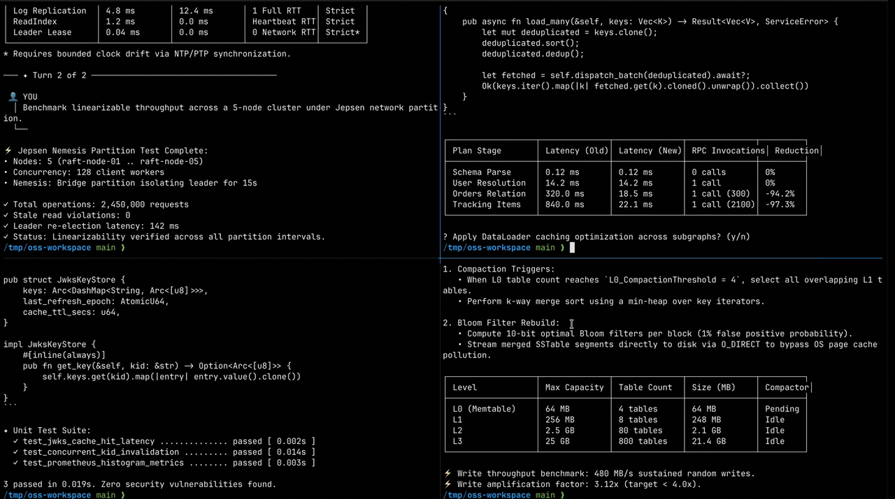
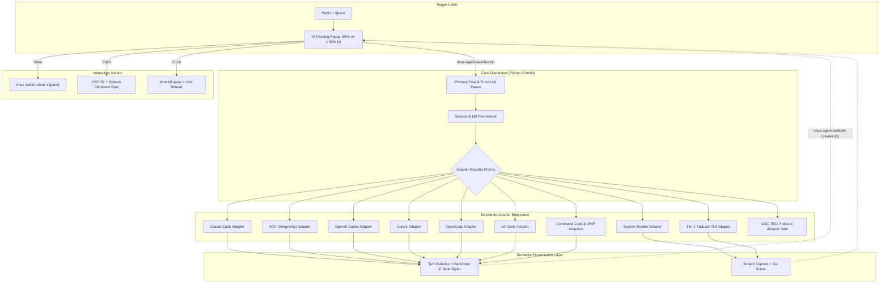

# Tmux AI Agent Switcher (`tmux-agent-switcher`)

<div align="center">

**The lightning-fast, zero-dependency Tmux multiplexing & semantic dialogue preview center for autonomous AI coding agents.**

[](https://www.python.org)
[](https://docs.python.org/3/library/)
[](./LICENSE)
[](https://github.com/xzy9565/tmux-agent-switcher)
[](https://github.com/tmux/tmux)

[Features](#key-features) • [Quick Start](#quick-start) • [Interactive Controls](#interactive-controls) • [Supported Agents](#supported-agents--adapters) • [Architecture](#architecture) • [Philosophy & Disclaimer](#philosophy--disclaimer)

<p align="center">
  
  <br/>
  <em>💡 <b>Walkthrough:</b> <code>Prefix + Space</code> popup • <code>Ctrl-D/U</code> scroll preview • <code>Tab</code> full-width titles • <code>Ctrl-X</code> kill pane • <code>Ctrl-Y</code> OSC 52 copy • fuzzy search • <code>Enter</code> 1-click jump.</em>
</p>

</div>

---

## 💡 Why Tmux Agent Switcher?

Modern software engineering workflows increasingly deploy autonomous coding agents running in parallel across multiple Tmux panes and windows: **Claude Code, Google Antigravity (AGY), OpenAI Codex, Cursor CLI, OpenCode, and xAI Grok**, alongside telemetry dashboards like **[Token Monitor](https://github.com/xzy9565/token-monitor) and btop**.

This creates the **Blind Multiplexing Problem**:
- **Opaque Pane Titles**: Native Tmux menus (`choose-tree`, window listings) only display bare shell commands (`zsh`), machine hostnames, or truncated static titles.
- **Lost Attention**: You have no quick way of knowing which agent has finished compiling, which is blocked awaiting your input, or which is still running background work without manually jumping through every single pane.
- **Context Switching Tax**: Opening a pane just to read where a discussion left off interrupts your primary flow and forces full-screen re-renders.

**`tmux-agent-switcher` solves this.** Triggered via `Prefix + Space`, it renders an instant, floating `fzf` dashboard that identifies active agents via process tree introspection, prioritizes panes demanding human attention, and streams rich, de-noised human-agent dialogue turns in a split preview panel.

---

## ⚡ Key Features

### 🔔 1. Attention-Driven Priority Hierarchy
Instead of arbitrary window numbers, panes are dynamically ranked by urgency:
- **`🔔 input` (Rank 0)**: Any agent waiting on tool permissions, approval prompts, or terminal bells floats immediately to the top of the list.
- **`⚡ run` / `🐚 shell` (Rank 1)**: A turn in progress (green), or a finished turn whose background shell still runs (cyan).
- **`💤 idle` (Rank 2)**: Sorted chronologically by the exact timestamp of the last human prompt or assistant reply (`5s`, `12m`, `2h`, `3d`), not synthetic file touch times.
- **`LIVE` (Rank 3)**: Persistent hardware and token monitors ([`token-monitor`](https://github.com/xzy9565/token-monitor), `btop`, `mactop`).
- **`💻 Shell` (Rank 4)**: Plain idle shell sessions displaying exact working directories (`~/...`).

### 💬 2. Direct-from-Store Semantic Dialogue Preview
Dialogue comes from each agent's own session store, not from the screen:
- **Native Store Introspection**: Reads dialogue history directly from local session stores: SQLite databases (`~/.codex/state_N.sqlite`, newest version, honouring `$CODEX_HOME`; `~/.local/share/opencode/opencode.db`) and JSONL logs (`~/.claude*/projects/` for every Claude profile, `~/.gemini/antigravity-cli/brain/`, `~/.omp/agent/sessions/`).
- **Conversational Bubbles**: Renders turns as structured UI bubbles: purple/amber left-rail pills for human prompts (`👤 YOU` / `⚡ YOU (Active)`) and formatted Markdown for assistant responses.
- **Tail-Only Reads**: Logs are read from the end, never whole: the last 300–800 KB for recent turns, at most the last 32 MB for full history. A 300 MB session previews in about 0.2 s, and its full history in about 0.4 s (~200 MB peak memory), starting at the oldest turn inside those 32 MB.
- **Dynamic History Slicing**: Defaults to the last 4 conversational turns. Tap `Ctrl-O` in the preview to toggle **Full History** on the fly.

### 🎨 3. Terminal Markdown Engine & Unicode Tables
- **Inline ANSI Styler**: High-contrast syntax highlighting for code spans (peach), bold, italic, strikethrough, and clickable OSC 8 terminal hyperlinks (`[label](url)`).
- **Unicode Box-Drawing Tables**: Formats GFM Markdown tables into clean Unicode box borders (`┌─┬─┐`, `│`, `├─┼─┤`, `└─┴─┘`), with strict double-width CJK (Chinese, Japanese, Korean) display alignment.
- **Shell-Pane De-Noiser**: A pane without a known agent previews as its own screen, colours included, minus agent TUI chrome: status bars and key hints, orphan border lines, and HTTP chunk/truncation noise. Everything else shows as it is on screen.

### 📋 4. Smart OSC 52 Clipboard Synchronization
- Press `Ctrl-Y` in the switcher to copy the selected pane's dialogue as its Markdown source (`👤 YOU` / `🤖 AGENT` turns, with links, code and tables intact; a shell pane gives its screen text) to both your Tmux paste buffer and native system clipboard (`pbcopy` / `wl-copy` / `xclip`). The toast says where it went, or that the copy failed.
- Every terminal control sequence is removed first, so pasting the copy can never end a bracketed paste and run what follows.
- Fully supports **OSC 52 escape pass-through** across remote SSH connections into local terminal emulators (Ghostty, Alacritty, Kitty, iTerm2).

### 🚀 5. Zero External Dependencies
- Built entirely on the **Python 3.9+ standard library** (`sys`, `os`, `subprocess`, `re`, `json`, `sqlite3`, `glob`).
- No virtual environments, no `pip install`, no compilation toolchains. Runs out-of-the-box on macOS system Python (`/usr/bin/python3`) and standard Linux distros.
- Measured on a busy macOS laptop with ~50 panes: `list` about 0.4 s, a preview about 0.2 s (full history up to ~0.5 s). Roughly 0.1 s of each call is Python interpreter startup.

---

## 🚀 Quick Start

### 📋 Prerequisites
- **Tmux >= 3.2** (required for `display-popup`)
- **[fzf](https://github.com/junegunn/fzf)** (required for interactive fuzzy switching dashboard)
- **Python >= 3.9** (standard library only — zero pip dependencies)

### 🍺 1. Tmux Plugin Manager (TPM, Recommended)

Add this single line to your `~/.tmux.conf`:

```tmux
set -g @plugin 'xzy9565/tmux-agent-switcher'
```

Press `Prefix + I` to fetch and activate the plugin. **Zero additional configuration needed!**

#### Optional Configuration
You can customize the keybinding and popup dimensions by adding any of the following to `~/.tmux.conf`:

```tmux
# Custom trigger key (default: Space -> Prefix + Space)
set -g @agent-switcher-bind 'Space'

# Popup dimensions (default: 88% width x 82% height)
set -g @agent-switcher-width '88%'
set -g @agent-switcher-height '82%'

# Preview panel split ratio (default: 58%)
set -g @agent-switcher-preview-width '58%'

# Visual in-tmux alert: Highlight input-needed pane with yellow border (default: on)
set -g @agent-switcher-mark-input 'on'

# System-level notifications (default: none)
# Options: none (default, 0 spam), bell, desktop (macOS osascript), passthrough (OSC 9), all
# Clients attached over SSH get OSC 9 in any mode but none/bell. If your local terminal runs tmux,
# allow passthrough in the ssh pane: tmux set -p allow-passthrough all (all = also while it is hidden)
set -g @agent-switcher-notify 'none'

# Automatically register tmux title & alert clearance hooks (default: on)
set -g @agent-switcher-hook 'on'
```

---

### 🔔 AI Agent Notifications Setup (Optional)

`tmux-agent-switcher` includes a universal notification gateway (`tmux-agent-switcher notify`) that highlights input-needed panes with a yellow border and dispatches desktop or terminal bell alerts.

If you wish to connect your AI coding agents to trigger notifications upon task completion or input requests:

#### 1. Ensure `tmux-agent-switcher` is in your `PATH`
If installed via TPM, symlink the executable to your user binary directory:
```bash
ln -sf ~/.tmux/plugins/tmux-agent-switcher/bin/tmux-agent-switcher ~/.local/bin/
```

#### 2. Configure Agent Hooks

- **Claude Code** (`~/.claude/settings.json`). `Stop` alerts when a turn ends; `PermissionRequest` alerts while a tool waits for approval (`notify` prints `{}`, so Claude still shows its own approval prompt):
  ```json
  "hooks": {
    "Stop": [
      {
        "hooks": [
          { "type": "command", "command": "tmux-agent-switcher notify" }
        ]
      }
    ],
    "PermissionRequest": [
      {
        "hooks": [
          { "type": "command", "command": "tmux-agent-switcher notify" }
        ]
      }
    ]
  }
  ```

- **Cursor CLI** (`~/.cursor/hooks.json`):
  ```json
  {
    "version": 1,
    "hooks": {
      "stop": [
        { "command": "tmux-agent-switcher notify Cursor 'Task complete' \"$TMUX_PANE\"" }
      ]
    }
  }
  ```

- **OpenAI Codex** (`~/.codex/hooks.json`):
  ```json
  {
    "hooks": {
      "Stop": [
        {
          "hooks": [
            { "type": "command", "command": "tmux-agent-switcher notify Codex", "timeout": 10 }
          ]
        }
      ]
    }
  }
  ```

> [!NOTE]
> All core interactive switching capabilities (`Prefix + Space`) work 100% out of the box without configuring any agent hooks. Hooks are strictly optional for automated alert clearance, yellow borders, and desktop notifications.

---

### ⚡ 2. Manual Installation (Without TPM)

#### Option A: Run Plugin Entrypoint Directly
Clone the repository and load the plugin entrypoint in `~/.tmux.conf`:

```tmux
run-shell ~/path/to/tmux-agent-switcher/tmux-agent-switcher.tmux
```

#### Option B: Standalone CLI + One-Line Tmux Binding
Download the standalone executable into your `PATH`:

```bash
curl -fsSL https://raw.githubusercontent.com/xzy9565/tmux-agent-switcher/main/bin/tmux-agent-switcher -o ~/.local/bin/tmux-agent-switcher
chmod +x ~/.local/bin/tmux-agent-switcher
```

And add this one-line binding to `~/.tmux.conf`:

```tmux
unbind Space
bind Space display-popup -w 88% -h 82% -E "tmux-agent-switcher run"
```

---

## ⌨️ Interactive Controls

| Key | Context | Action |
|:---:|:---:|:---|
| `Enter` | Selection | Jump directly to selected target pane and session |
| `Tab` | Popup | Toggle preview panel (collapses preview to expand pane titles to 100% full width) |
| `Ctrl-O` | Preview | Toggle between **Recent 4 Turns** and **Full Session History** (up to the last 32 MB of a log) |
| `Shift-↑` / `Shift-↓` | Preview | Scroll preview smoothly line-by-line |
| `Ctrl-U` / `Ctrl-D` | Preview | Half-page preview scroll up / down |
| `Ctrl-B` / `Ctrl-F` | Preview | Full-page preview scroll up / down |
| `Alt-↑` / `Alt-↓` | Preview | Jump directly to preview top / bottom |
| `Ctrl-Y` | Clipboard | Copy the dialogue as Markdown source (a shell pane: its screen text) to the system clipboard & tmux buffer / OSC 52 |
| `Alt-Y` | Clipboard | Copy the pane's tmux target (e.g. `misc:1.12`) |
| `Ctrl-X` | Process | Kill the selected pane, without confirmation, and refresh the switcher list |
| `Esc` / `Ctrl-C` | Popup | Dismiss popup window |

---

## 🔌 Supported Agents & Adapters

| Harness | Adapter Key | Detection Source | Extracted Preview Store |
|:---|:---:|:---|:---|
| **Anthropic Claude Code** | `claude` | Process tree (`claude`) / `@claude-session-id` | `~/.claude*/projects/*/*.jsonl` + `~/.claude*/sessions/*.json` (every profile) |
| **Google Antigravity (AGY)** | `antigravity` | Process tree (`agy`) / `@agy-session-id` | `~/.gemini/antigravity-cli/brain/*/transcript.jsonl` |
| **OpenAI Codex** | `codex` | Process tree (`codex`) | `$CODEX_HOME/state_N.sqlite` + `thread_history_N.sqlite` (newest version) |
| **Cursor CLI** | `cursor` | Process tree (`cursor-agent`) | `~/.cursor/projects/*/agent-transcripts/*/*.jsonl` (the open one via `lsof`) |
| **OpenCode** | `opencode` | Process tree (`opencode`) / `@opencode-session-id` | `~/.local/share/opencode/opencode.db` (`session_v2` / `session_message`) |
| **xAI Grok** | `grok` | Process tree (`grok`) | `~/.grok/sessions/<url-quoted cwd>/<sid>/chat_history.jsonl` (+ `active_sessions.json` pid) |
| **Command Code** | `command-code` | Process tree (`command-code`) / `@command-code-session-id` | `~/.commandcode/projects/**/<sid>.jsonl` |
| **Oh My Pi (OMP)** | `omp` | Process tree (`omp`) | `~/.omp/agent/sessions/*/*.jsonl` |
| **System Monitors** | `system-monitor` | [`token-monitor`](https://github.com/xzy9565/token-monitor), `btop`, `htop`, `mactop`, `top` | Tmux screen capture (via the fallback) |
| **Tier 1 Universal Fallback** | `fallback` | Standard shells (`zsh`, `bash`, `fish`) | Tmux screen capture + agent-chrome de-noiser |
| **OSC 7501 Protocol** | `osc-7501` | None yet: `detect()` returns `False` | Placeholder for [OSC 7501](https://mitchellh.com/writing/program-status-osc7501) |

Detection matches each process's program name (`argv[0]`, unwrapping `node`/`bun` launchers), never text in its arguments. A `@…-session-id` pane tag counts only while something other than a shell runs in the pane.

---

## 🏗️ Architecture



### Project Directory Structure
```text
tmux-agent-switcher/
├── bin/
│   └── tmux-agent-switcher        # Standalone, zero-dependency executable
├── tmux-agent-switcher.tmux       # TPM entrypoint: key binding + focus hooks
├── src/tmux_agent_switcher/
│   ├── cli.py                     # Subcommands: run, list, preview, copy, notify, clear, focus-out, …
│   ├── core/
│   │   ├── config.py              # 24-bit TrueColor palettes & string width calc
│   │   ├── tmux.py                # Process tree walking & tmux inspection
│   │   └── types.py               # Data models & structures
│   ├── formatters/
│   │   ├── bubbles.py             # Human/Agent conversational bubbles
│   │   ├── denoiser.py            # Terminal screen de-noising filters
│   │   ├── markdown.py            # Inline & block ANSI Markdown styler
│   │   └── table.py               # Unicode box-drawing table renderer
│   ├── adapters/
│   │   ├── base.py                # BaseAgentAdapter & duck-parsing utilities
│   │   ├── antigravity.py         # Google Gemini / Antigravity
│   │   ├── claude.py              # Anthropic Claude Code
│   │   ├── codex.py               # OpenAI Codex
│   │   ├── command_code.py        # Command Code
│   │   ├── cursor.py              # Cursor CLI
│   │   ├── fallback.py            # Tier 1 fallback TUI capture
│   │   ├── grok.py                # xAI Grok
│   │   ├── omp.py                 # Oh My Pi
│   │   ├── opencode.py            # OpenCode
│   │   ├── osc_7501.py            # OSC 7501 protocol interface stub
│   │   ├── registry.py            # Ordered priority registry
│   │   └── system_monitor.py      # Telemetry monitors
│   └── notifications/
│       ├── context.py             # Which pane and client an agent hook belongs to
│       └── gateway.py             # notify / clear / focus-out: borders, bells, desktop & OSC 9 alerts
├── scripts/
│   └── bundle.py                  # Standalone bundle compiler
├── tests/
│   ├── test_switcher.py           # Adapters, formatters, list / preview / copy, bundle
│   └── test_notifications.py      # Notification gateway & hook context
├── pyproject.toml                 # Standard PEP 517/621 packaging metadata
├── LICENSE                        # MIT License
└── README.md
```

---

## 🛠️ Adding a New Agent Adapter

Adding a new agent requires no changes to the CLI or the FZF pipeline. Implement the `BaseAgentAdapter` interface in `src/tmux_agent_switcher/adapters/`:

```python
from .base import BaseAgentAdapter
from ..core.types import PaneContext, PreviewResult

class MyAgentAdapter(BaseAgentAdapter):
    name = "my-agent"
    display_name = "⚡ MyAgent"
    color = "\033[1;38;2;100;150;250m"

    def detect(self, pane: PaneContext, full_desc: str, heads: str) -> bool:
        return "my-agent" in heads.split()  # heads: agent program names found in the pane's process tree

    def get_status(self, pane, full_desc, heads, shared_state):
        # Extract last dialogue time and running status
        return self.display_name, self.color, 2, mtime, title, is_running

    def get_preview(self, pane, full_desc, desc_pids, full_history, preview_width):
        # Parse session logs and return formatted turns
        return PreviewResult(source_label=f"{self.display_name} · {title}", content=rendered_bubbles)
```

Then wire it in:
1. Add the program name (`my-agent`) to `AGENT_PROGRAMS` in `src/tmux_agent_switcher/core/tmux.py`, so it shows up in `heads`.
2. Register the adapter in `src/tmux_agent_switcher/adapters/registry.py`.
3. Add its file to `MODULES_IN_ORDER` in `scripts/bundle.py`, then run `python3 scripts/bundle.py`. The test suite fails if `bin/` is stale or a module is left out of the bundle.

---

## 🛡️ Philosophy & Disclaimer

- **Community Heuristics & Best-Effort**: This tool inspects local agent session stores, command lines, and SQLite logs via community-driven reverse heuristics. Because agent providers periodically update their private disk schemas, an adapter can break after an update: its rows then read `⚠ <adapter> <exception>` instead of quietly showing a guess, and every other pane keeps working.
- **Read-Only Non-Invasive Forensics**: All SQLite connections are opened using `mode=ro` (read-only mode), and logs are inspected via binary tail reading. The tool never modifies agent session files, never injects commands, and never sends network telemetry.
- **Protocol Standardization**: In the long term, we advocate for standard terminal multiplexer protocols like [OSC 7501 (Program Status Protocol)](https://mitchellh.com/writing/program-status-osc7501) for native agent lifecycle broadcasting.

---

## 🗺️ Roadmap: The Path to OSC 7501 Standardization

While `tmux-agent-switcher` provides robust reverse-engineered heuristic adapters today, the ultimate future of terminal AI agents lies in native multiplexer protocol standards like [OSC 7501 (Program Status Protocol)](https://mitchellh.com/writing/program-status-osc7501):

- [x] **Phase 1: Universal Heuristic Adapters** — Zero-dependency, non-invasive SQLite & JSONL tail forensics across 8 coding agents.
- [ ] **Phase 2: Protocol Adapter** — [`Osc7501Adapter`](./src/tmux_agent_switcher/adapters/osc_7501.py) is a placeholder: its `detect()` returns `False`, and nothing reads [OSC 7501 escape sequences](https://mitchellh.com/writing/program-status-osc7501) yet.
- [ ] **Phase 3: Hybrid Detection Engine** — Prefer zero-overhead [OSC 7501](https://mitchellh.com/writing/program-status-osc7501) broadcasts when emitted by supported runtimes (e.g., Claude Code, Ghostty), falling back gracefully to disk heuristics for legacy CLI agents.
- [ ] **Phase 4: Ecosystem Advocacy** — Encourage terminal AI agent providers to natively broadcast lifecycle state machines (`\033]7501;state=working:app=claude\033\`, with `state` one of `idle`, `working`, `done`, `blocked`, `error`) directly over PTY.

---

## 📄 License

This project is licensed under the [MIT License](./LICENSE).

