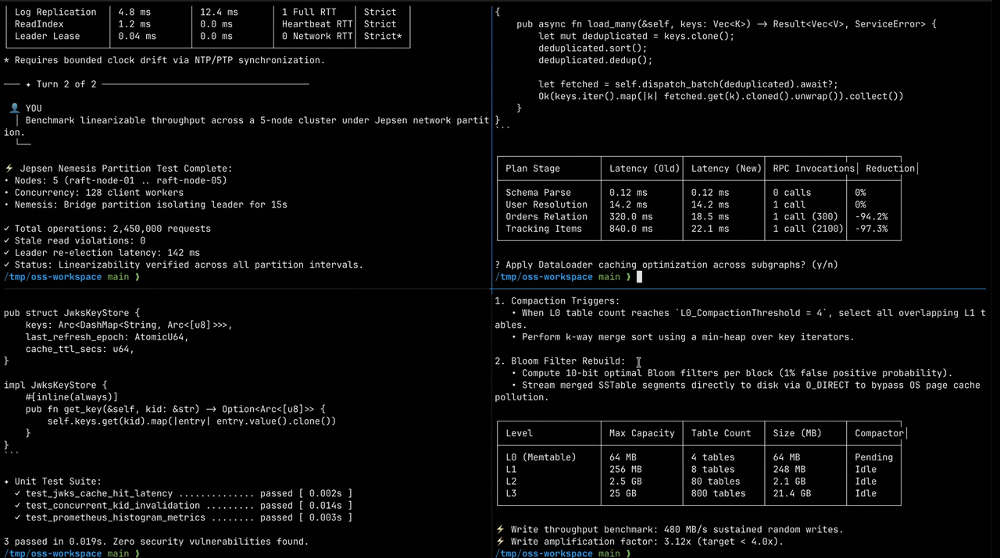
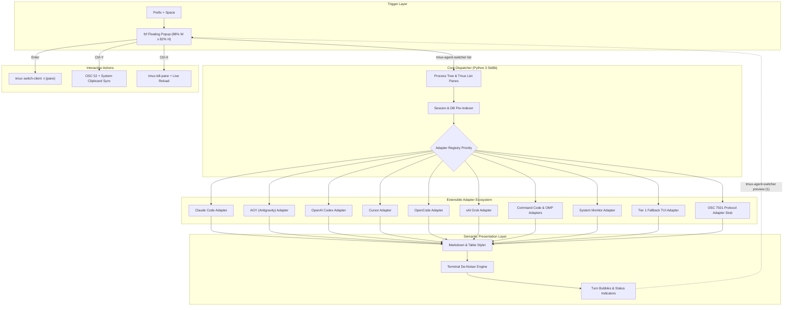

# Tmux AI Agent Switcher (`tmux-agent-switcher`)

<div align="center">

**The lightning-fast, zero-dependency Tmux multiplexing & semantic dialogue preview center for autonomous AI coding agents.**

[](https://www.python.org)
[](https://docs.python.org/3/library/)
[](./LICENSE)
[](https://github.com/xzy9565/tmux-agent-switcher)
[](https://github.com/tmux/tmux)

[Features](#key-features) • [Quick Start](#quick-start) • [Interactive Controls](#interactive-controls) • [Supported Agents](#supported-agents--adapters) • [Architecture](#architecture) • [Philosophy & Disclaimer](#philosophy--disclaimer)

<p align="center">
  
  <br/>
  <em>💡 <b>Walkthrough:</b> <code>Prefix + Space</code> popup • <code>Ctrl-D/U</code> scroll preview • <code>Tab</code> full-width titles • <code>Ctrl-X</code> kill pane • <code>Ctrl-Y</code> OSC 52 copy • fuzzy search • <code>Enter</code> 1-click jump.</em>
</p>

</div>

---

## 💡 Why Tmux Agent Switcher?

Modern software engineering workflows increasingly deploy autonomous coding agents running in parallel across multiple Tmux panes and windows: **Claude Code, Google Antigravity (AGY), OpenAI Codex, Cursor CLI, OpenCode, and xAI Grok**, alongside telemetry dashboards like **[Token Monitor](https://github.com/xzy9565/token-monitor) and btop**.

This creates the **Blind Multiplexing Problem**:
- **Opaque Pane Titles**: Native Tmux menus (`choose-tree`, window listings) only display bare shell commands (`zsh`), machine hostnames, or truncated static titles.
- **Lost Attention**: You have no quick way of knowing which agent has finished compiling, which is blocked awaiting your input, or which subagent is executing in the background without manually jumping through every single pane.
- **Context Switching Tax**: Opening a pane just to read where a discussion left off interrupts your primary flow and forces full-screen re-renders.

**`tmux-agent-switcher` solves this.** Triggered via `Prefix + Space`, it renders an instant, floating `fzf` dashboard that identifies active agents via process tree introspection, prioritizes panes demanding human attention, and streams rich, de-noised human-agent dialogue turns in a split preview panel.

---

## ⚡ Key Features

### 🔔 1. Attention-Driven Priority Hierarchy
Instead of arbitrary window numbers, panes are dynamically ranked by urgency:
- **`🔔 input` (Rank 0)**: Any agent waiting on tool permissions, approval prompts, or terminal bells floats immediately to the top of the list.
- **`⚡ run` / `🤖 subagent` (Rank 1)**: Actively computing turns and background processes are highlighted in vibrant green/cyan.
- **`💤 idle` (Rank 2)**: Sorted chronologically by the exact timestamp of the last human prompt or assistant reply (`5s`, `12m`, `2h`, `3d`), not synthetic file touch times.
- **`LIVE` (Rank 3)**: Persistent hardware and token monitors ([`token-monitor`](https://github.com/xzy9565/token-monitor), `btop`, `mactop`).
- **`💻 Shell` (Rank 4)**: Plain idle shell sessions displaying exact working directories (`~/...`).

### 💬 2. Direct-from-Store Semantic Dialogue Preview
Zero synthetic scraping or terminal screen tearing:
- **Native Store Introspection**: Reads dialogue history directly from local session stores: SQLite databases (`~/.codex/state_5.sqlite`, `~/.local/share/opencode/opencode.db`) and JSONL loggers (`~/.claude/projects/`, `~/.gemini/antigravity-cli/brain/`, `~/.omp/agent/sessions/`).
- **Conversational Bubbles**: Renders turns as structured UI bubbles: purple/amber left-rail pills for human prompts (`👤 YOU` / `⚡ YOU (Active)`) and formatted Markdown for assistant responses.
- **Memory-Guarded Binary Reverse-Seeking**: Inspects large multi-gigabyte logs using backwards byte offsets (<300 KB window) — sub-30ms response times with zero memory bloat.
- **Dynamic History Slicing**: Defaults to the last 4 conversational turns. Tap `Ctrl-O` in the preview to toggle **Full History** on the fly.

### 🎨 3. Terminal Markdown Engine & Unicode Tables
- **Inline ANSI Styler**: High-contrast syntax highlighting for code spans (peach), bold, italic, strikethrough, and clickable OSC 8 terminal hyperlinks (`[label](url)`).
- **Unicode Box-Drawing Tables**: Formats GFM Markdown tables into clean Unicode box borders (`┌─┬─┐`, `│`, `├─┼─┤`, `└─┴─┘`), with strict double-width CJK (Chinese, Japanese, Korean) display alignment.
- **Intelligent De-Noiser**: Strips ASCII spinners, braille frames, terminal status bars, shell prompts (`❯`), and HTTP chunk transfer noise.

### 📋 4. Smart OSC 52 Clipboard Synchronization
- Press `Ctrl-Y` in the switcher to strip ANSI codes and copy the unwrapped dialogue of the selected pane directly to both your Tmux paste buffer and native system clipboard (`pbcopy` / `wl-copy` / `xclip`).
- Fully supports **OSC 52 escape pass-through** across remote SSH connections into local terminal emulators (Ghostty, Alacritty, Kitty, iTerm2).

### 🚀 5. Zero External Dependencies & Sub-30ms Launch
- Built entirely on the **Python 3.9+ standard library** (`sys`, `os`, `subprocess`, `re`, `json`, `sqlite3`, `glob`).
- No virtual environments, no `pip install`, no compilation toolchains. Runs out-of-the-box on macOS system Python (`/usr/bin/python3`) and standard Linux distros.

---

## 🚀 Quick Start

### 📋 Prerequisites
- **Tmux >= 3.2** (required for `display-popup`)
- **[fzf](https://github.com/junegunn/fzf)** (required for interactive fuzzy switching dashboard)
- **Python >= 3.9** (standard library only — zero pip dependencies)

### 🍺 1. Tmux Plugin Manager (TPM, Recommended)

Add this single line to your `~/.tmux.conf`:

```tmux
set -g @plugin 'xzy9565/tmux-agent-switcher'
```

Press `Prefix + I` to fetch and activate the plugin. **Zero additional configuration needed!**

#### Optional Configuration
You can customize the keybinding and popup dimensions by adding any of the following to `~/.tmux.conf`:

```tmux
# Custom trigger key (default: Space -> Prefix + Space)
set -g @agent-switcher-bind 'Space'

# Popup dimensions (default: 88% width x 82% height)
set -g @agent-switcher-width '88%'
set -g @agent-switcher-height '82%'

# Preview panel split ratio (default: 58%)
set -g @agent-switcher-preview-width '58%'
```

---

### ⚡ 2. Manual Installation (Without TPM)

#### Option A: Run Plugin Entrypoint Directly
Clone the repository and load the plugin entrypoint in `~/.tmux.conf`:

```tmux
run-shell ~/path/to/tmux-agent-switcher/tmux-agent-switcher.tmux
```

#### Option B: Standalone CLI + One-Line Tmux Binding
Download the standalone executable into your `PATH`:

```bash
curl -fsSL https://raw.githubusercontent.com/xzy9565/tmux-agent-switcher/main/bin/tmux-agent-switcher -o ~/.local/bin/tmux-agent-switcher
chmod +x ~/.local/bin/tmux-agent-switcher
```

And add this one-line binding to `~/.tmux.conf`:

```tmux
unbind Space
bind Space display-popup -w 88% -h 82% -E "tmux-agent-switcher run"
```

---

## ⌨️ Interactive Controls

| Key | Context | Action |
|:---:|:---:|:---|
| `Enter` | Selection | Jump directly to selected target pane and session |
| `Tab` | Popup | Toggle preview panel (collapses preview to expand pane titles to 100% full width) |
| `Ctrl-O` | Preview | Toggle between **Recent 4 Turns** and **Full Session History** |
| `Shift-↑` / `Shift-↓` | Preview | Scroll preview smoothly line-by-line |
| `Ctrl-U` / `Ctrl-D` | Preview | Half-page preview scroll up / down |
| `Ctrl-B` / `Ctrl-F` | Preview | Full-page preview scroll up / down |
| `Alt-↑` / `Alt-↓` | Preview | Jump directly to preview top / bottom |
| `Ctrl-Y` | Clipboard | Copy unwrapped conversation text to system clipboard & OSC 52 buffer |
| `Alt-Y` | Clipboard | Copy Tmux target pane identifier (e.g. `%43`) |
| `Ctrl-X` | Process | Kill target orphan pane and automatically refresh the switcher list |
| `Esc` / `Ctrl-C` | Popup | Dismiss popup window |

---

## 🔌 Supported Agents & Adapters

| Harness | Adapter Key | Detection Source | Extracted Preview Store |
|:---|:---:|:---|:---|
| **Anthropic Claude Code** | `claude` | Process tree / `@claude-session-id` | `~/.claude/projects/*/*.jsonl` + `sessions/*.json` |
| **Google Antigravity (AGY)** | `antigravity` | Process tree / `@agy-session-id` | `~/.gemini/antigravity-cli/brain/*/transcript.jsonl` |
| **OpenAI Codex** | `codex` | Process tree (`@openai/codex`) | `~/.codex/state_5.sqlite` + `thread_history_1.sqlite` |
| **Cursor CLI** | `cursor` | Process tree (`cursor-agent`) / `lsof` | `~/.cursor/projects/*/agent-transcripts/*/*.jsonl` |
| **OpenCode** | `opencode` | Process tree / `@opencode-session-id` | `~/.local/share/opencode/opencode.db` (session/part) |
| **xAI Grok** | `grok` | Process tree (`grok`) | `~/.grok/active_sessions.json` + `chat_history.jsonl` |
| **Command Code** | `command-code` | Process tree / `@command-code-session-id` | `~/.commandcode/projects/*/*.jsonl` |
| **Oh My Pi (OMP)** | `omp` | Process tree (`omp`) / `@omp-session-id` | `~/.omp/agent/sessions/*/*.jsonl` |
| **System Monitors** | `system-monitor` | [`token-monitor`](https://github.com/xzy9565/token-monitor), `btop`, `htop`, `mactop`, `top` | Fallback TUI de-noiser + real-time buffer capture |
| **Tier 1 Universal Fallback** | `fallback` | Standard shells (`zsh`, `bash`, `fish`) | Tmux screen capture + semantic ANSI de-noiser |
| **OSC 7501 Protocol** | `osc-7501` | Semantic agent terminal escapes | Forward-looking protocol bridge |

---

## 🏗️ Architecture



### Project Directory Structure
```text
tmux-agent-switcher/
├── bin/
│   └── tmux-agent-switcher        # Standalone, zero-dependency executable
├── src/tmux_agent_switcher/
│   ├── cli.py                     # Subcommand dispatch (list, preview, copy, popup)
│   ├── core/
│   │   ├── config.py              # 24-bit TrueColor palettes & string width calc
│   │   ├── tmux.py                # Process tree walking & tmux inspection
│   │   └── types.py               # Data models & structures
│   ├── formatters/
│   │   ├── bubbles.py             # Human/Agent conversational bubbles
│   │   ├── denoiser.py            # Terminal screen de-noising filters
│   │   ├── markdown.py            # Inline & block ANSI Markdown styler
│   │   └── table.py               # Unicode box-drawing table renderer
│   └── adapters/
│       ├── base.py                # BaseAgentAdapter & duck-parsing utilities
│       ├── antigravity.py         # Google Gemini / Antigravity
│       ├── claude.py              # Anthropic Claude Code
│       ├── codex.py               # OpenAI Codex
│       ├── command_code.py        # Command Code
│       ├── cursor.py              # Cursor CLI
│       ├── fallback.py            # Tier 1 fallback TUI capture
│       ├── grok.py                # xAI Grok
│       ├── omp.py                 # Oh My Pi
│       ├── opencode.py            # OpenCode
│       ├── osc_7501.py            # OSC 7501 protocol interface stub
│       ├── registry.py            # Ordered priority registry
│       └── system_monitor.py      # Telemetry monitors
├── scripts/
│   └── bundle.py                  # Standalone bundle compiler
├── tests/
│   └── test_switcher.py           # Comprehensive automated test suite
├── pyproject.toml                 # Standard PEP 517/621 packaging metadata
├── LICENSE                        # MIT License
└── README.md
```

---

## 🛠️ Adding a New Agent Adapter

Adding a new agent is simple and requires zero changes to the core CLI or FZF pipeline. Implement the `BaseAgentAdapter` interface in `src/tmux_agent_switcher/adapters/`:

```python
from .base import BaseAgentAdapter
from ..core.types import PaneContext, PreviewResult

class MyAgentAdapter(BaseAgentAdapter):
    name = "my-agent"
    display_name = "⚡ MyAgent"
    color = "\033[1;38;2;100;150;250m"

    def detect(self, pane: PaneContext, full_desc: str, heads: str) -> bool:
        return "my-agent" in heads or "my-agent" in pane.current_command

    def get_status(self, pane, full_desc, heads, shared_state):
        # Extract last dialogue time and running status
        return self.display_name, self.color, 2, mtime, title, is_running

    def get_preview(self, pane, full_desc, desc_pids, full_history, preview_width):
        # Parse session logs and return formatted turns
        return PreviewResult(source_label=f"{self.display_name} · {title}", content=rendered_bubbles)
```

Register your adapter in `src/tmux_agent_switcher/adapters/registry.py`, run `python3 scripts/bundle.py`, and test!

---

## 🛡️ Philosophy & Disclaimer

- **Community Heuristics & Best-Effort**: This tool inspects local agent session stores, command lines, and SQLite logs via community-driven reverse heuristics. Because agent providers periodically update their private disk schemas, adapters are built defensively to fall back gracefully without interrupting your workflow.
- **Read-Only Non-Invasive Forensics**: All SQLite connections are opened using `mode=ro` (read-only mode), and logs are inspected via binary tail reading. The tool never modifies agent session files, never injects commands, and never sends network telemetry.
- **Protocol Standardization**: In the long term, we advocate for standard terminal multiplexer protocols like [OSC 7501 (Program Status Protocol)](https://mitchellh.com/writing/program-status-osc7501) for native agent lifecycle broadcasting.

---

## 🗺️ Roadmap: The Path to OSC 7501 Standardization

While `tmux-agent-switcher` provides robust reverse-engineered heuristic adapters today, the ultimate future of terminal AI agents lies in native multiplexer protocol standards like [OSC 7501 (Program Status Protocol)](https://mitchellh.com/writing/program-status-osc7501):

- [x] **Phase 1: Universal Heuristic Adapters** — Zero-dependency, non-invasive SQLite & JSONL tail forensics across 10+ major coding agents.
- [x] **Phase 2: Protocol Interface Stub** — Embedded [`Osc7501Adapter`](./src/tmux_agent_switcher/adapters/osc_7501.py) ready for [OSC 7501 escape sequences](https://mitchellh.com/writing/program-status-osc7501).
- [ ] **Phase 3: Hybrid Detection Engine** — Prefer zero-overhead [OSC 7501](https://mitchellh.com/writing/program-status-osc7501) broadcasts when emitted by supported runtimes (e.g., Claude Code, Ghostty), falling back gracefully to disk heuristics for legacy CLI agents.
- [ ] **Phase 4: Ecosystem Advocacy** — Encourage terminal AI agent providers to natively broadcast lifecycle state machines (`\033]7501;state=busy;...\033\`) directly over PTY.

---

## 📄 License

This project is licensed under the [MIT License](./LICENSE).

